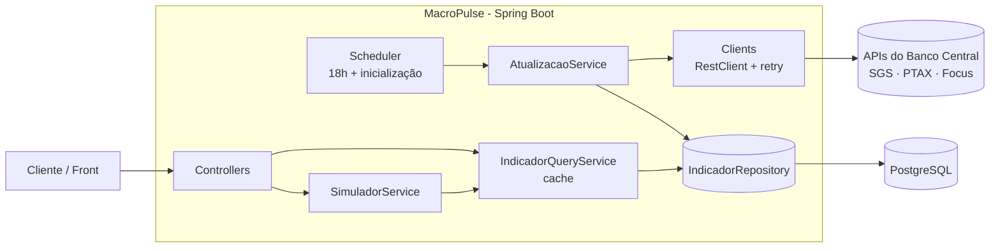

# 📈 MacroPulse

API REST de **indicadores macroeconômicos do Brasil**. Coleta diariamente dados oficiais do **Banco Central** (Selic, dólar, euro, IPCA e expectativa de inflação), guarda o histórico no PostgreSQL, calcula **juro real** e **variação cambial**, e oferece um **simulador de investimentos** (CDB, Tesouro Selic e poupança) com IR regressivo.


---

## ✨ Funcionalidades

- **Coleta automática** dos indicadores do Banco Central todo dia útil às 18h (horário de Brasília) e na inicialização da aplicação, buscando só os dias que faltam.
- **Cotações atuais e históricas** de Selic, dólar, euro e IPCA.
- **Juro real** pela fórmula de Fisher, usando a Selic atual e a expectativa de IPCA do boletim Focus.
- **Variação do dólar** nos últimos N dias.
- **Simulador de investimentos**: compara o rendimento líquido de CDB (% do CDI), Tesouro Selic e poupança, com IR regressivo.
- **Resiliência**: retry automático quando o Banco Central fica indisponível, e falhas isoladas por indicador (um indicador fora do ar não impede a atualização dos outros).
- **Cache** nas consultas, invalidado sempre que chegam dados novos.
- **Erros padronizados** no formato `ProblemDetail` (RFC 9457).
- **Documentação interativa** com Swagger (OpenAPI 3.1).

---

## 🏛️ Fontes de dados (Banco Central do Brasil)

| Indicador | API | Série / serviço | Frequência |
| --- | --- | --- | --- |
| Selic meta | SGS | série 432 | diária |
| IPCA | SGS | série 433 | mensal |
| Dólar (venda) | Olinda PTAX | `CotacaoDolarPeriodo` | dias úteis |
| Euro (venda, fechamento) | Olinda PTAX | `CotacaoMoedaPeriodo` | dias úteis |
| IPCA esperado 12 meses | Olinda Expectativas | `ExpectativasMercadoInflacao12Meses` (boletim Focus) | diária |

---

## 🛠️ Stack

- **Java 21** e **Spring Boot 4.1.2** (Spring Framework 7)
- **Spring Web MVC** + **RestClient** (consumo das APIs do BCB)
- **Spring Data JPA** + **PostgreSQL 16** + **Flyway** (migrations)
- **Spring Cache**, **`@Scheduled`** e **`@Retryable`** (resiliência nativa do Spring Framework 7)
- **Bean Validation** e **ProblemDetail**
- **springdoc-openapi** (Swagger UI)
- **JUnit 6**, **Mockito**, **AssertJ** e **MockMvc**
- **Docker** e **Docker Compose**

---

## 🧭 Arquitetura



- **Escrita e leitura separadas**: o `AtualizacaoService` busca e grava; o `IndicadorQueryService` só lê (com cache).
- Uma tabela `indicador` com `tipo`, `data` e `valor`, e uma constraint `UNIQUE (tipo, data)` que impede registros duplicados.

---

## 🚀 Como rodar

### Opção 1: tudo no Docker (recomendado)

Pré-requisito: apenas **Docker**.

```bash
git clone https://github.com/vinisl2510-sudo/macropulse.git
cd macropulse
docker compose up --build
```

Sobem dois containers: `macropulse-db` (PostgreSQL) e `macropulse-api`. A API só inicia depois que o banco está pronto (healthcheck) e, ao subir, já busca os dados no Banco Central.

- API: `http://localhost:8081`
- Swagger: **`http://localhost:8081/swagger-ui.html`**

### Opção 2: desenvolvimento (banco no Docker, API local)

Pré-requisitos: **Java 21** e **Docker**.

```bash
docker compose up -d db        # na raiz do repositório
cd back/macropulse
./mvnw spring-boot:run
```

O banco fica exposto na porta **5433** (para não conflitar com um PostgreSQL local na 5432).

---

## 📚 Endpoints

Documentação completa e testável no **Swagger** (`/swagger-ui.html`).

| Método | Rota | Descrição |
| --- | --- | --- |
| GET | `/api/indicadores/selic/atual` | Selic meta mais recente (% a.a.) |
| GET | `/api/indicadores/dolar/atual` | Cotação de venda do dólar mais recente |
| GET | `/api/indicadores/euro/atual` | Cotação de venda do euro mais recente |
| GET | `/api/indicadores/selic/historico?inicio=&fim=` | Selic no período |
| GET | `/api/indicadores/dolar/historico?inicio=&fim=` | Dólar no período |
| GET | `/api/indicadores/euro/historico?inicio=&fim=` | Euro no período |
| GET | `/api/indicadores/ipca/historico?inicio=&fim=` | IPCA mensal no período |
| GET | `/api/indicadores/dolar/variacao?dias=30` | Variação % do dólar nos últimos N dias |
| GET | `/api/indicadores/juro-real` | Juro real (Fisher) |
| POST | `/api/simulador` | Simulação de investimentos |

Datas no formato `yyyy-MM-dd`.

### Exemplo: simulador

```http
POST /api/simulador
Content-Type: application/json

{ "valor": 1000, "prazoDias": 365, "percentualCdi": 110 }
```

```json
{
  "valorInvestido": 1000,
  "prazoDias": 365,
  "selicUsada": 13.75,
  "resultados": [
    { "produto": "CDB 110% do CDI", "valorBruto": 1150.15, "rendimentoBruto": 150.15, "impostoRenda": 26.28, "valorLiquido": 1123.87, "rendimentoLiquido": 123.87 },
    { "produto": "Tesouro Selic",   "valorBruto": 1137.50, "rendimentoBruto": 137.50, "impostoRenda": 24.06, "valorLiquido": 1113.44, "rendimentoLiquido": 113.44 },
    { "produto": "Poupança",        "valorBruto": 1061.70, "rendimentoBruto": 61.70,  "impostoRenda": 0.00,  "valorLiquido": 1061.70, "rendimentoLiquido": 61.70 }
  ]
}
```

### Exemplo: erro de validação

```json
{
  "title": "Dados inválidos",
  "status": 400,
  "detail": "prazoDias: não deve ser nulo; valor: deve ser maior que 0",
  "instance": "/api/simulador"
}
```

---

## 🧮 Regras de negócio

**Juro real (Fisher)**

```
juro real = (1 + Selic) / (1 + IPCA esperado) − 1
```

Com Selic de 15% e IPCA esperado de 5%, o juro real é **9,52%**, e não 10% (a subtração simples é só uma aproximação).

**Simulador**

- **CDI** estimado como Selic − 0,10 p.p.
- **CDB**: rende o % do CDI informado. **Tesouro Selic**: rende a Selic.
- **Poupança**: 0,5% a.m. (≈ 6,17% a.a.) quando a Selic é maior que 8,5%; senão, 70% da Selic. Isenta de IR.
- **Juros compostos**: `valor × (1 + taxa)^(dias / 365)`.
- **IR regressivo** sobre o rendimento:

| Prazo | Alíquota |
| --- | --- |
| até 180 dias | 22,5% |
| 181 a 360 dias | 20% |
| 361 a 720 dias | 17,5% |
| acima de 720 dias | 15% |

Simplificações: sem IOF, sem TR na poupança, sem taxa de custódia, e Selic constante durante o prazo.

Todos os cálculos usam `BigDecimal` com arredondamento `HALF_UP`.

---

## 🧪 Testes

```bash
docker compose up -d db        # na raiz do repositório
cd back/macropulse
./mvnw test
```

17 testes (o `contextLoads` precisa do PostgreSQL do compose rodando):

- **`SimuladorServiceTest`** (unitário): os três produtos, as duas regras da poupança e as faixas do IR com teste de valor-limite (`@ParameterizedTest`).
- **`IndicadorQueryServiceTest`** (unitário): juro real (inclusive negativo), variação do dólar em alta e em queda, e o 404 quando não há dados.
- **`SimuladorControllerTest`** (`@WebMvcTest`): 200 com JSON válido; 400 com dados inválidos sem chegar no service.

Nos testes, a atualização automática na inicialização é desligada (`macropulse.atualizacao.na-inicializacao=false`), então a suíte **não depende da internet** nem do Banco Central.

---

## 📁 Estrutura

O repositório é um **monorepo**: backend e front-end ficam juntos, cada um na sua pasta (veja [docs/MONOREPO.md](docs/MONOREPO.md)).

```
macropulse/
├── docker-compose.yml     # sobe o banco e a API
├── README.md
├── docs/                  # documentação didática
├── front/                 # front-end
└── back/macropulse/       # API Java (src, pom.xml, mvnw, Dockerfile)
```

Código da API, dentro de `back/macropulse`:

```
src/main/java/io/github/vinisl2510/macropulse
├── client        # chamadas às APIs do Banco Central (RestClient + @Retryable)
├── config        # RestClient, cache, agendamento, retry e OpenAPI
├── controller    # endpoints REST
├── dto           # bcb (respostas do BCB), request e response
├── exception     # exceções e GlobalExceptionHandler (ProblemDetail)
├── model         # entidade Indicador e enum TipoIndicador
├── repository    # Spring Data JPA
├── scheduler     # atualização diária e na inicialização
└── service       # atualização, consultas/cálculos e simulador
```

---

## 🗺️ Roadmap

- [x] Coleta de Selic, dólar e IPCA esperado
- [x] Endpoints de cotação atual e histórico
- [x] Atualização agendada e cache
- [x] Juro real e variação do dólar
- [x] Euro, IPCA realizado e retry
- [x] Simulador de investimentos
- [x] Testes automatizados
- [x] Swagger e Docker
- [ ] Front-end (cards, gráficos e tela do simulador)
- [ ] Deploy

---

## 👤 Autor

Feito por Vinicius Soares Loureiro como projeto de portfólio para vagas de backend no mercado financeiro.

- GitHub: [@vinisl2510-sudo](https://github.com/vinisl2510-sudo)
- LinkedIn: www.linkedin.com/in/vinícius-soares-loureiro-9bb96b34b


Os dados são públicos e de responsabilidade do Banco Central do Brasil. Este projeto não é recomendação de investimento.